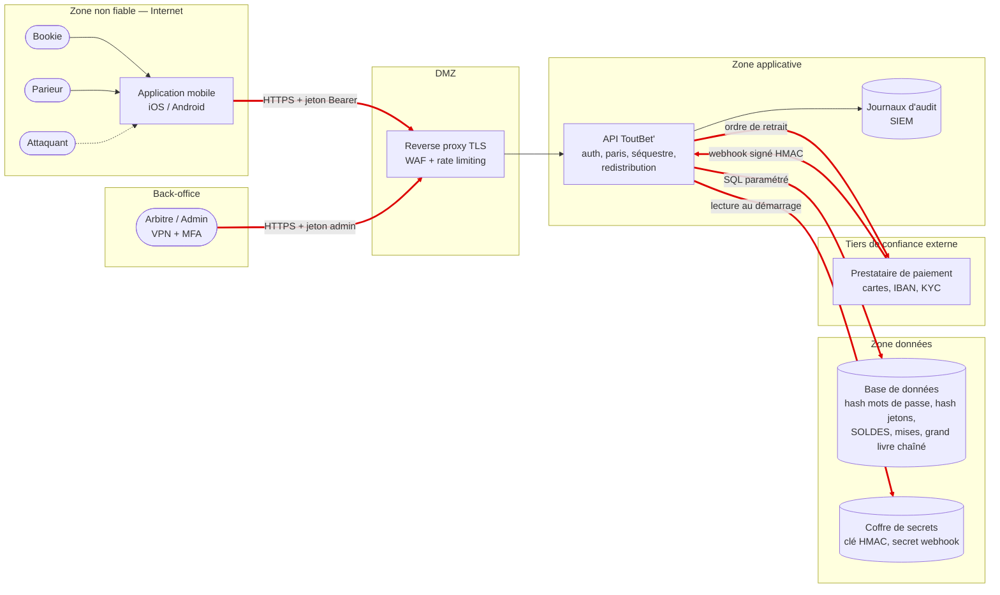

# Atelier 1 — Conception sécurisée et modélisation des menaces

**Projet :** ToutBet' — plateforme mobile-first de paris personnalisés entre particuliers
**Porteur :** Youssef Bamou
**Membre du groupe :** Youssef Bamou
**Dépôt :** https://github.com/youssefbamou/toutbet-mvp

---

## Étape 1 — Backlog produit / MVP

Chaque récit utilisateur (User Story) est associé à sa version malveillante (Abuse Story).
La colonne « Test » renvoie au test automatisé de l'atelier 2 (`tests/test_abuse_stories.py`).

| # | User Story | Abuse Story | Test |
|---|---|---|---|
| 1 | En tant que **visiteur**, je veux créer un compte et me connecter pour accéder à mes paris. | En tant qu'**attaquant**, je veux deviner le mot de passe d'un parieur par force brute pour vider son compte. | `TestAS01BruteForce` |
| 2 | En tant que **parieur**, je veux déposer de l'argent sur mon portefeuille pour pouvoir miser. | En tant que **fraudeur**, je veux forger ou rejouer une notification de paiement pour être crédité sans payer. | `TestAS02FakeDeposit` |
| 3 | En tant que **bookie**, je veux créer un pari (« Matis va-t-il réussir son créneau ? ») avec une date de clôture, une mise minimum et ma commission. | En tant que **bookie malhonnête**, je veux fixer une commission abusive ou une date déjà passée pour piéger les parieurs. | `TestAS03AbusiveBet` |
| 4 | En tant que **bookie**, je veux inviter des parieurs pour que seuls mes amis voient et jouent mon pari. | En tant que **curieux**, je veux consulter un pari privé ou y miser sans être invité (IDOR). | `TestAS04PrivateBetAccess` |
| 5 | En tant que **parieur**, je veux miser 10 € pour montrer que j'ai raison. | En tant que **parieur malveillant**, je veux miser un montant négatif ou supérieur à mon solde pour créer de l'argent. | `TestAS05MoneyCreation` |
| 6 | En tant que **parieur**, je veux consulter mon pari et obtenir une preuve de ma mise. | En tant que **parieur malveillant**, je veux modifier mon pari après sa clôture pour remporter la mise. | `TestAS06ModifyAfterClose` |
| 7 | En tant que **bookie**, je veux déclarer le résultat une fois l'événement terminé. | En tant que **parieur ou bookie malhonnête**, je veux déclarer un faux résultat, le déclarer avant la fin ou parier sur mon propre pari. | `TestAS07ResultManipulation` |
| 8 | En tant que **parieur**, je veux contester un résultat que j'estime faux. | En tant que **perdant**, je veux nier avoir parié (répudiation) ou contester sans fin pour bloquer la redistribution. | `TestAS08Repudiation` |
| 9 | En tant que **gagnant**, je veux recevoir automatiquement mes gains, commissions déduites. | En tant que **gagnant malin**, je veux déclencher deux fois la redistribution pour être payé deux fois. | `TestAS09DoublePayout` |
| 10 | En tant qu'**arbitre (admin)**, je veux trancher les litiges et annuler un pari frauduleux. | En tant qu'**utilisateur malveillant**, je veux m'octroyer les droits administrateur pour trancher à mon avantage. | `TestAS10PrivilegeEscalation` |
| 11 | En tant que **parieur**, je veux retirer mes gains sur mon compte bancaire. | En tant que **parieur malveillant**, je veux lancer des retraits simultanés pour retirer plus que mon solde. | `test_concurrency.py` |
| 12 | En tant que **parieur**, je veux que l'application reste rapide pendant les grands événements. | En tant qu'**attaquant**, je veux saturer l'API pendant une finale (DoS), ou provoquer des erreurs pour découvrir sa structure interne. | `TestAS12DenialOfService`, `TestAS11InjectionAndLeaks`, `load/locustfile.py` |

---

## Étape 2 — Architecture et frontières de confiance

Les flèches **rouges** franchissent une frontière de confiance (la confiance change).

**Frontières de confiance (lignes rouges)**

| # | Frontière | Pourquoi la confiance change | Contrôles |
|---|---|---|---|
| FC1 | Smartphone → reverse proxy | Le client est entièrement contrôlé par l'utilisateur : toute donnée reçue est hostile. | TLS, jeton Bearer, validation stricte, rate limiting, WAF |
| FC2 | API → base de données | La base contient les soldes et le grand livre : c'est le cœur de la valeur. | Requêtes paramétrées, compte SQL à privilèges minimaux, contraintes CHECK et triggers |
| FC3 | API → coffre de secrets | Les secrets permettent de forger des reçus et des dépôts. | Injection au démarrage, jamais dans le code ni dans Git, rotation |
| FC4 | API ↔ prestataire de paiement (deux sens) | Les entrées venant du prestataire peuvent être usurpées, et ce qui sort vers lui engage de l'argent réel. | Signature HMAC, idempotence, montants plafonnés, retrait seulement après débit atomique |
| FC5 | Back-office admin → API | Rôle privilégié : peut trancher et annuler. | Réseau restreint (VPN), MFA, rôle vérifié côté serveur, audit |

**Où sont les données sensibles**

| Donnée | Emplacement | Protection |
|---|---|---|
| Soldes, mises, grand livre | Base de données | Contraintes en base, grand livre append-only chaîné par HMAC |
| Mots de passe | Base de données | Hachage scrypt (werkzeug) |
| Jetons de session | Mobile (Keychain / Keystore) et base | En base : seulement le hash SHA-256 ; expiration 1 h |
| Clé HMAC, secret webhook (clés privées) | Coffre / variables d'environnement | Jamais versionnés (`.gitignore`, `.env.example`) |
| Cartes bancaires, IBAN, pièces d'identité KYC | Chez le prestataire de paiement uniquement | Ne transitent jamais par ToutBet' (périmètre PCI-DSS réduit) |

---

## Étape 3 — Modélisation STRIDE des menaces

| Catégorie | Menace identifiée | Composant visé | Mitigation proposée (et implémentée) |
|---|---|---|---|
| **S**poofing | Vol de compte par force brute ou credential stuffing | API `/auth/login` | Verrouillage après 5 échecs, scrypt, message d'erreur identique que le compte existe ou non (pas d'énumération) |
| Spoofing | Rejeu ou forge d'un jeton de session | API (authentification) | Jeton aléatoire de 256 bits, stocké haché, expiration 1 h, révocation à la déconnexion |
| Spoofing | Faux webhook « paiement réussi » | API ↔ prestataire (FC4) | Signature HMAC-SHA256 vérifiée à temps constant sur le corps brut |
| Spoofing | Fraude à l'identité, multi-comptes | Inscription | KYC délégué au prestataire avant tout retrait (hors MVP) |
| **T**ampering | Modification d'une mise après clôture | Base (mises) | Aucune route PUT/PATCH/DELETE, triggers d'immuabilité, contrôle de clôture dans la transaction |
| Tampering | Montant négatif ou décimal pour créer de l'argent | API `/wagers`, `/withdraw` | Entiers stricts > 0 (pydantic), plafonds, `CHECK (balance_cents >= 0)` |
| Tampering | Manipulation du résultat par un tiers ou avant la fin | API `/result` | Seul le bookie, seulement après clôture, état figé une fois proposé |
| Tampering | Bookie qui mise sur son propre pari | API `/wagers` | Interdit par le serveur (403) |
| Tampering | Modification directe des soldes en base | Base de données | Écriture des soldes uniquement via `register_transaction`, grand livre chaîné : toute altération casse la chaîne |
| **R**épudiation | Un perdant nie avoir effectué le pari | Logs / base | Reçu de mise signé (HMAC) remis au parieur, grand livre append-only chaîné, journal d'audit horodaté |
| Répudiation | Le bookie nie avoir déclaré le résultat | Logs / base | Journal d'audit : auteur, date, valeur proposée |
| **I**nformation disclosure | Stacktrace ou SQL renvoyé au client | API (erreurs) | Gestionnaire d'erreurs générique, identifiant de requête, stacktrace seulement dans les logs |
| Information disclosure | Consultation des paris privés d'autrui (IDOR) | API `/bets/{id}` | 404 hors bookie, invités et admin ; portefeuille toujours celui du jeton |
| Information disclosure | Versions logicielles exposées | En-tête HTTP `Server` | En-tête neutralisé |
| Information disclosure | Secrets dans le dépôt Git | Dépôt / CI | Variables d'environnement, `.gitignore`, analyse des secrets (Semgrep `p/secrets`) |
| **D**éni de service | Afflux massif lors d'un grand événement | Reverse proxy, API | Rate limiting par IP, corps limité à 16 Ko, test de charge Locust |
| Déni de service | Requêtes conçues pour planter le serveur (fuzzing) | API | Validation stricte, bornes sur les identifiants, tests de fuzzing en CI |
| Déni de service | Contestations en boucle pour bloquer les gains | API `/dispute` | Une seule contestation par parieur, uniquement pendant le délai, arbitrage admin |
| **E**lévation de privilèges | S'attribuer le rôle admin à l'inscription | API `/register` | Champs inconnus refusés (`extra=forbid`), rôle attribué uniquement en ligne de commande |
| Élévation de privilèges | Action admin (annuler, trancher) par un simple utilisateur | API `/cancel`, `/settle` | Contrôle du rôle côté serveur, jamais côté client |

---

## Étape 4 — Prototype généré par IA

Les prompts utilisés sont dans [`docs/PROMPTS.md`](PROMPTS.md). Le code généré a été testé (261 tests),
analysé et corrigé, puis historisé dans le dépôt public : https://github.com/youssefbamou/toutbet-mvp
